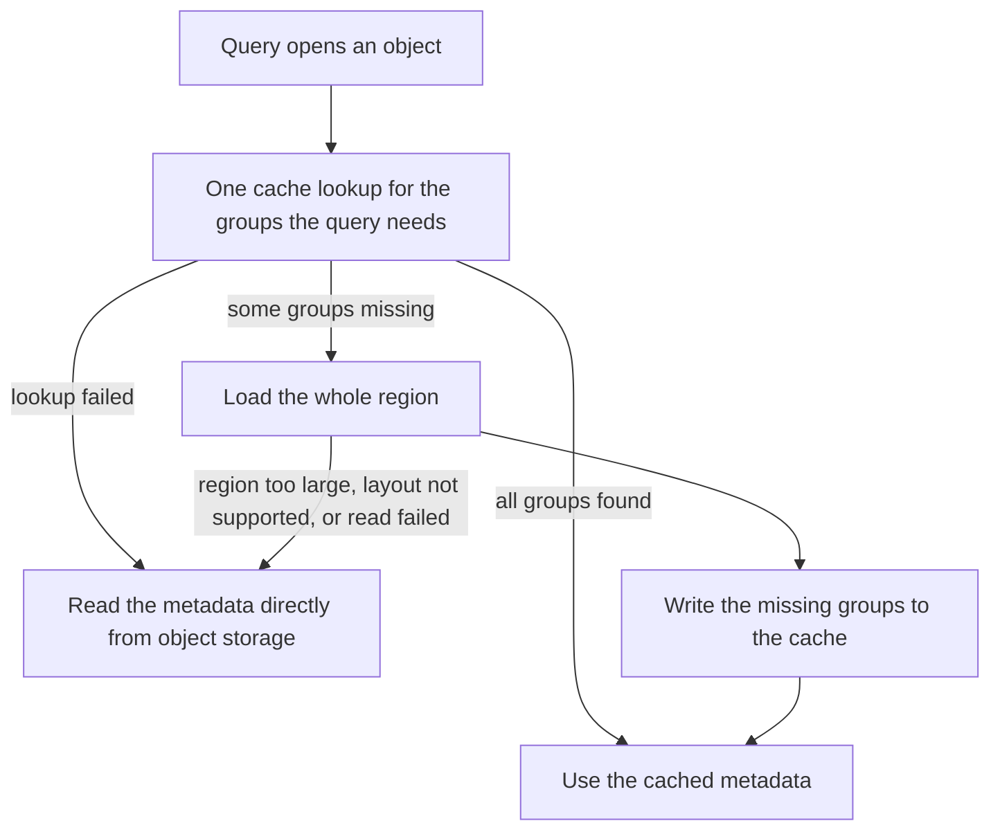
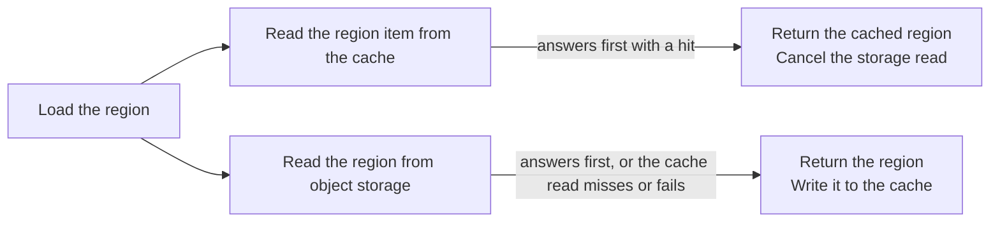

# Caching the metadata of data objects

This document describes how queriers cache the metadata of data objects, and why the caches work the
way they do. Data objects and the metadata prefetcher are experimental.

## Purpose

A query opens a data object before it reads any section. To open it, the querier reads the metadata:
the header, the file metadata that lists the sections, and the metadata of the sections and columns
that the query reads. Without a cache, a cold open needs several object storage reads, one after the
other. A query opens many objects, so this latency adds up.

Metadata is small (compared to the whole object size) and an object never changes after it is written.
Every query that touches an object needs nearly the same bytes. So queriers keep the metadata in a cache that
they share. A querier that starts cold, or opens an object for the first time, finds the metadata that
another querier cached. The cache needs no invalidation: compaction writes new objects, and it never
edits old ones.

## Which cache serves what

| Object | Served by |
|---|---|
| Index objects | the metadata cache |
| Log objects | the metadata cache, or the metadata prefetcher when it is enabled |

The prefetcher is opt-in. When it is enabled, it takes over the log objects, and the metadata cache does
not serve them any more. A querier never uses both for one object. When the prefetcher cannot serve a log
object, the querier reads the metadata directly from object storage.

Both store their items in the same cache backend, for example memcached, under different keys.

## The metadata cache

The metadata cache keeps one cache item for each object, under the path of the object. A lookup reads one
key. On a miss, the querier reads the object from object storage and stores the item. Concurrent misses
for one object in one querier share one read, and the read has a time limit. A cache that fails costs
time and nothing more: the querier reads the object directly. The cache does not store an item above the
item size limit of the backend.

### Index objects

The cache holds the metadata region of an index object, or the whole object when it is tiny. An index
object has few sections with a fixed schema, its metadata is tens of kilobytes, and a query reads whole
sections. So one item for the object is the right shape. A hit replaces the first read of the open. A
tiny object is kept whole, so a warm open reads nothing from object storage.

### Log objects, when the prefetcher is off

The cache holds the object from its start to the end of the metadata of the last section that is not a
logs section. A tiny object is kept whole. The cache leaves out the metadata of the logs sections on
purpose, because it grows with the number of columns. But the item is one contiguous prefix, so it also
holds the metadata of every logs section that lies before the last non-logs section. In compacted objects
the small streams section lies among the logs sections, so the item can be megabytes. When that prefix
does not fit in the item size limit, the item holds only the file metadata.

This shape does not fit log objects well:

- A query fetches the whole item, even when it reads only a few columns.
- What the item holds depends on the order of the sections in the object, and not on what a query needs.
- The metadata of the logs sections that lies after the prefix still needs reads from object storage.

The prefetcher exists to fix this.

## The metadata prefetcher

The prefetcher takes over the metadata cache for log objects. It applies to the log objects that a querier
opens to serve a stream-first metric query from data objects. In this section, "the cache" means the
cache items of the prefetcher.

### What the cache holds

The metadata region of an object is the part from its start to the end of the metadata of all its
sections.

```
| header + file metadata | section metadata ... | section data ... |
|<------------ metadata region ------------>|   not cached
```

The cache does not hold section data. A section can hold a lot of it, and it would push the metadata
out of the cache. Metadata is the part that every query reuses.

The cache holds the region in two shapes:

- **Groups.** Each group is a small cache item. The groups are:
  - The file metadata.
  - The core metadata that every query needs: the stream ID and timestamp columns, and the non-log
    sections.
  - The log line column.
  - One group for each structured metadata column.
- **The whole region.** One cache item holds all of it.

A query tells the cache which metadata it needs, and the cache returns only the groups for it. A query
that filters on one structured metadata column then prefetches a few kilobytes, and not the whole
region. The whole region serves the queries that need all the metadata, and it is the source for the
groups.

### How a query reads metadata



- **Load the whole region on a miss.** One or two large reads cost less than the many small reads of
  a direct open. The load writes the groups that the query missed. When the cache does not know the
  object at all, it writes every group, so a later query that needs other metadata of the same object
  also hits.
- **Never fail because of the cache.** Every path that cannot use the cache ends in the direct read,
  as if there were no cache. After a failed lookup, the query goes straight to the direct read.
  Loading the whole region would cost more, and a failed cache cannot take the fill.

#### Loading the whole region



The load does not know if the cache holds the region, so it reads from both at the same time. The
first answer wins. We race the request to the cache and storage because:

- Asking the cache first, and object storage after (sequentially), would add a round trip to every miss. Racing the
  two requests avoid the 2x round trip on a cache miss.
- The storage read also protects the query from a slow cache.

The price is a storage read that a cache hit makes unnecessary. The price is small. The load is the
last resort, after a group miss. It leaves the groups in the cache, so the next request for the object
stops at the groups. The load also cancels the storage read when the cache answers first.

### Size limit

The cache skips an object whose metadata region is above a limit. Moving a very large region costs
more than the direct read saves. A cache item also cannot be larger than the item size limit of the
cache backend. Loki checks at startup that the limit fits in a cache item.

### Cache items

A cache item has these properties:

- **Collision resistant.** The cache stores an item under a hash of its key, because backends limit
  the length of a key. The item also holds the full key, so a reader detects a hash collision.
- **Corruption resistant.** A checksum detects a truncated or corrupt item.
- **Versioned.** Old and new queriers share the cache during a rollout, and the layout of an item can
  change between them.
- **Compressed.** Metadata compresses well, which saves cache memory and network bandwidth. Small items
  and items that compress poorly stay uncompressed, so the querier spends no CPU for no gain.

A reader treats an item that fails a check as a miss, and the next write replaces it. A wrong or
damaged cache costs time, and it cannot change the result of a query.
