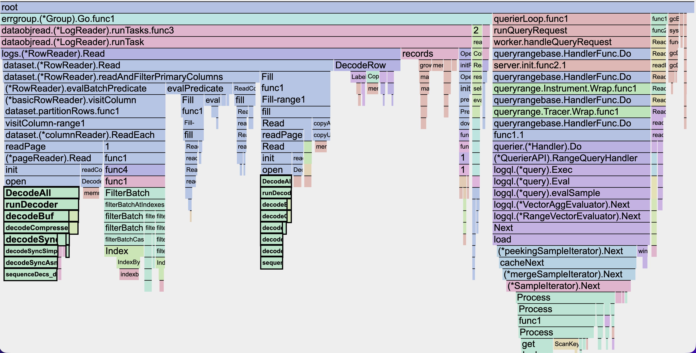

# FSST encoding for log message pages

**Author:** @dimitarvdimitrov

**Date:** 11/2026

**Sponsor(s):** Marco Pracucci (@pracucci), Ben Clive (@benclive)

**Type:** Feature

**Status:** In discussion

**Related issues/PRs:** TBD

---

## Background

Log message columns currently use plain, length-prefixed strings with Zstd compression.
To decode individual strings the reader decompresses the complete values block.

[Fast Static Symbol Table (FSST)](https://www.vldb.org/pvldb/vol13/p2649-boncz.pdf) uses a trained table of symbols to compress strings.
Each symbol represents up to eight bytes.
Multiple strings can share one table and remain independently decodable.

The optimized benchmarks use [the FSST fork at revision `ee30e95`](https://github.com/dimitarvdimitrov/fsst/commit/ee30e95db62e).
The fork starts from [axiomhq/fsst revision `392aa0d`](https://github.com/axiomhq/fsst/tree/392aa0d5eac7621f855b80df1fd6dc71f204a94f).
It adapts `DecodeBatch` to the existing checked eight-symbol kernel.

## Problem Statement

The current layout couples string access to whole-page decompression.
Zstd decompression takes a noticeable part of the CPU time in the Loki querier.
During one query surge, it accounted for 15% of CPU time (see the [querier CPU profile in the appendix](#querier-cpu-profile)).

We want to explore a layout that provides independent access to compressed strings and reduces the decompression overhead.

## Goals

- Find a cheaper replacement for Zstd for log message columns.
- Remove the varint length prefix from each string.
- Permit selective string decompression in a later reader optimization.
- TODO: format migration & compatibility guarantees

## Non-Goals

- Change compression of other column types.

## Proposal overview

Each challenge below compares alternatives and identifies the preferred proposal.
The selected layout uses one FSST table per page, fixed-width symbol offsets, and a separate array of decoded lengths.

FSST acts as a value encoding.
Message columns use `ENCODING_TYPE_FSST` with `COMPRESSION_TYPE_NONE`.

Each page uses its own FSST table.
The page stores the resulting byte ranges in an offsets array next to the FSST table and the symbol sequences.
Symbol sequences contain codes that reference table entries, plus literal escapes for bytes without a symbol match.

In practice, the page contains:

```text
<presence bitmap size>
<presence bitmap>
<serialized FSST table>
<symbol offsets: uint32[N+1]>
<decoded lengths: uint32[N]>
<symbol sequences>

N = number of non-NULL strings
```

Offsets and decoded lengths use little-endian integers.
Offsets refer to byte positions within the symbol sequences.
The first offset is zero.
The final offset equals the total size of the symbol sequences in bytes.

String `i` occupies:

```text
symbolSequences[offsets[i]:offsets[i+1]]
```

`decodedLengths[i]` gives the output size for string `i` in bytes.
The decoder sums these lengths to allocate a buffer for a selected batch before decompression.
Empty strings have length zero. NULL rows have no offset or length entry.
The presence bitmap retains its existing page header.

Offsets identify the symbol sequence for each string.
The FSST table contains symbols and their byte lengths, but no string boundaries.

The reader can decode each string independently from its symbol sequence.
This permits future changes to `pageReader` that skip unwanted values without the current read-and-discard path in `skipUnwantedRows`.

## Challenge 1: Choose the FSST table scope

### Proposal A: One table per page (preferred)

Each page carries its own FSST table.
Pages have no shared dictionary dependencies but require repeated table training.

A table per page gives compaction the most flexibility.
Compaction can retain an encoded page without a dependency on the table of its source object or column.
If compaction changes a page, only that page needs a new table and re-encoding.

### Symbol table and small-page overhead

Each page carries a symbol table with a fixed 16-byte header plus symbol bytes.
The 2026-11-20 rerun includes symbol offsets and the selected decoded-length array. All sizes are bytes:

| Page values | FSST table | FSST payload | Symbol offsets | Decoded lengths | FSST total | Zstd total |
| --- | ---: | ---: | ---: | ---: | ---: | ---: |
| `["1"]` | 17 | 1 | 8 | 4 | 30 | 15 |
| Ten strings, `"0"`–`"9"` | 26 | 10 | 44 | 40 | 120 | 33 |
| 10,000 cyclic digits | 26 | 10,000 | 40,004 | 40,000 | 90,030 | 43 |

FSST amplifies the original bytes by 30×, 12×, and approximately 9×, respectively.
One-byte strings receive no payload reduction, so the two integer arrays dominate storage.
Zstd includes varint string lengths and its frame checksum. All three Zstd presets produce the same sizes for these cases.

These totals exclude Loki headers, presence bitmaps, and descriptors.
With the Loki envelope, the FSST pages contain 33, 123, and 90,035 bytes, respectively.
No additional total decoded size is necessary because the decoder can sum the stored lengths.
Full results reside in `fsst-go/results/decoded-length-storage.md`. Independent repeats produce identical sizes.

### Proposal B: One table per column

All pages in a message column share one FSST table.
Pages depend on that column's table for decompression.

### Proposal C: One table per data object

All message pages in the data object share one FSST table.
If new data changes the table, all existing pages in the object require re-encoding.

## Challenge 2: Choose how to use FSST

### Proposal A: Use a separate encoding with symbol offsets (preferred)

FSST acts as a value encoding with a dedicated page format, as described in the [proposal overview](#proposal-overview).
Symbol offsets preserve direct access to each compressed string.

The dedicated format permits random access decompression and future reader optimizations that skip unwanted values.
The other two proposals require whole-page decompression for individual strings.

FSST can produce larger output than Zstd.
The latest log-page sizes are 257,825 bytes for FSST and 139,902 bytes for Zstd `SpeedFastest`, approximately 1.84× as many bytes.

### Proposal B: Compress concatenated strings and their lengths

This approach applies FSST to the existing stream of length-prefixed strings.
It fits the existing compression hooks, retains per-string varints, and requires whole-page decompression.

### Proposal C: Compress concatenated strings with decoded offsets

This approach removes per-string varints and preserves decoded boundaries.
Individual strings still require whole-page decompression.

## Challenge 3: Right-size decompression buffers

The decoder needs the decoded length to allocate the output buffer before decompression.
The proposals differ in how the decoder obtains that length.

### Proposal A: Do not store decoded lengths

The decoder derives output lengths from symbols and literal escapes.
It can reuse a sufficiently large buffer, scan the encoded strings before allocation, or grow the buffer during decompression.
The benchmark uses `DecodeBatch` with buffer growth when necessary.
This approach saves four bytes per value but increases allocation costs with fresh output buffers.

### Proposal B: Store decoded lengths beside symbol offsets

The page stores `(symbol offset, decoded length)` pairs, followed by the final symbol offset.
Both integers use `uint32`, so decoded lengths add four bytes per non-NULL string.
The decoder reads the lengths to allocate an output buffer for one string or a selected batch.
The interleaved directory requires a different stride for symbol offsets.

### Proposal C: Store decoded lengths in a separate sequence (preferred)

The page stores `uint32[N]` decoded lengths after the `uint32[N+1]` symbol offsets.
It has the same storage cost as Proposal B and preserves a contiguous symbol-offset array.
The decoder sums the selected lengths before allocation, then calls `DecodeBatch`.
This layout is easier to reason about, and the measurements show no consistent performance penalty relative to interleaved entries.

### Comparison

The following medians use the 2,048-row log page and `DecodeBatch` for all three layouts.
Throughput uses decoded MB/s. Warm cases reuse output buffers. Cold cases allocate fresh output buffers with the table already loaded.

| Layout | Page bytes | Warm random value | Warm whole page | Cold whole page |
| --- | ---: | ---: | ---: | ---: |
| A: No decoded lengths | 249,633 | 4,043 | 4,820 | 1,123 |
| B: Interleaved lengths | 257,825 | 3,927 | 4,822 | 2,832 |
| C: Separate lengths | 257,825 | 4,024 | 4,828 | 2,822 |

Both length layouts add 8,192 bytes (3.28%) and reduce cold whole-page allocation from 4,145,920 bytes across 33 allocations to 845,824 bytes across two.
Per-row `DecodeIntoExact` is slower with warm buffers: separate lengths reach 3,063 MB/s for random values and 3,219 MB/s for whole pages.
Stored lengths therefore support exact allocation with the existing batch decoder.
Full results reside in `fsst-go/results/loki-decoded-length-summary.json`.

## Challenge 4: Store symbol offsets

### Proposal A: Store uint32 offsets (preferred)

Fixed-width symbol offsets cost four bytes per boundary (`<symbol offsets: uint32[N+1]>`).
Short strings can therefore require more boundary metadata than varint lengths.
Fixed-width offsets permit direct string access without a prefix scan or a reconstructed offset array.
The log-page measurements show a small space cost and substantially higher throughput for random access.

### Proposal B: Store varint lengths

The `fsst-varint` fixture replaces `uint32[N+1]` offsets with one unsigned varint compressed length per non-NULL string.
Both layouts use identical symbol tables and payloads.
Varint lengths require a prefix scan or a reconstructed offset array before direct access.

### Comparison

All page sizes are in bytes:

| Page values | uint32 boundaries | varint boundaries | uint32 page | varint page |
| --- | ---: | ---: | ---: | ---: |
| `["1"]` | 8 | 1 | 29 | 22 |
| Ten strings, `"0"`–`"9"` | 44 | 10 | 83 | 49 |
| 10,000 cyclic digits | 40,004 | 10,000 | 50,035 | 20,031 |
| 2,048 synthetic log strings | 8,196 | 2,730 | 249,633 | 244,167 |

This earlier experiment omits per-value decoded lengths in both layouts.
Page sizes include the header and presence bitmap but exclude descriptor metadata.
Varints save 5,466 bytes (2.19%) on the log page, versus 41% on the ten-digit page.
They require a prefix scan or a reconstructed offset array before direct access.
The existing `DecodeBatch` accepts that reconstructed array.
Full results reside in `fsst-go/results/loki-pages-varint.json`.

Warm decode throughput for the 2,048-row log page, in decoded MB/s:

| Decode mode | uint32 offsets | varint lengths |
| --- | ---: | ---: |
| Random single value | 4,447 | 183 |
| Whole page | 4,961 | 4,863 |

The timer includes boundary parsing and FSST decode, but excludes table construction, bitmap processing, CRC32C, and I/O.
Full results reside in `fsst-go/results/loki-boundary-decode-summary.json`.

## Other Notes

### Benchmark results

The 2026-11-20 runs compare the selected separate length array with pages that omit decoded lengths.
Both use `DecodeBatch`, the FSST fork at `ee30e95`, and the same table and symbol payload.
The host uses an Apple M1 Pro, Go 1.27.2, and one benchmark worker.

The fixture contains 2,048 synthetic service-log strings and 819,418 decoded bytes. Each string contains 40–1,023 bytes.
FSST trains on the page itself, outside the timer.
Each case has five samples of at least 200 ms, followed by an independent repeat.
Rates below are medians in decimal MB/s of decoded string bytes.

| Access pattern | No lengths | Separate lengths | No lengths, repeat | Separate lengths, repeat |
| --- | ---: | ---: | ---: | ---: |
| Warm random single values | 4,043 | 4,024 | 3,971 | 3,960 |
| Warm sequential single values | 4,184 | 4,158 | 4,135 | 4,096 |
| Warm contiguous batches of 32 | 4,947 | 4,865 | 4,824 | 4,763 |
| Warm whole page | 4,820 | 4,828 | 4,834 | 4,741 |
| Cold random single values | 720 | 1,565 | 608 | 1,451 |
| Cold whole page | 1,123 | 2,822 | 901 | 2,730 |

Warm cases reuse output buffers and allocate zero bytes.
Cold cases discard output bytes and decoded offsets before each request. The table and source-offset scratch space remain loaded.
Warm log medians differ by at most 3.07% between runs. Cold medians differ by up to 19.75%, but retain the allocation benefit.

The timer includes directory reads, output allocation, FSST decode, and a small output checksum.
It excludes table training and construction, bitmap processing, CRC32C, and I/O.
These are decoder measurements, not complete Loki reader measurements. The latest run does not measure encode throughput or Zstd decode throughput.

The selected FSST page occupies 257,825 bytes, including the header and presence bitmap but excluding the descriptor.
Zstd `SpeedFastest` occupies 139,902 bytes for the same fixture.
The earlier codec throughput comparison remains in `fsst-go/RESEARCH.md`.
Full results and reproduction commands reside in `fsst-go/results/decoded-lengths.md` and `fsst-go/results/decoded-length-storage.md`.

### Integration

`tableBuffer.Message` selects the new encoding.
A dedicated FSST encoder and decoder retain the existing plain encoding for other columns.

The encoder buffers strings until the page flush.
It trains one table and encodes the strings.
It writes the table, symbol offsets, decoded lengths, and symbol sequences.
The buffer must own the string bytes until the flush.

`compressWriter.Reset` uses its existing pass-through path.
`MemPage.open` retains the FSST payload in encoded form.
The value decoder owns FSST decompression.

The reader initially decodes requested sequential batches.
Offsets also permit direct access to individual compressed strings.
Predicate-aware access remains future work.
The current reader still decodes skipped rows, so offsets alone do not provide that optimization.

The page descriptor contains `ValuesCount`, which identifies the number of offsets.
The value decoder constructor currently accepts only bytes.
The integration needs count propagation or a count within the payload.
This detail remains open.

Page size estimates must include buffered strings before the encoder flush.
Uncompressed size statistics must describe decoded data.
CRC32 and stored size statistics must include the table, symbol offsets, and decoded lengths.

### Protobuf changes

The prototype adds `ENCODING_TYPE_FSST` to `EncodingType`.
The dedicated Makefile target regenerates `datasetmd.pb.go`:

```bash
make pkg/dataobj/internal/metadata/datasetmd/datasetmd.pb.go
```

The broad `make protos` target deletes all generated protobuf files before regeneration.
The dedicated target limits regeneration to the affected file.

No FSST compression enum is necessary for this approach.
The table, symbol offsets, and decoded lengths reside within the page payload.
They need no additional protobuf fields.

### String boundaries and decoded lengths illustration

This example illustrates the layout from the [proposal overview](#proposal-overview).

```text
FSST table:
    A → "hello"
    B → "world"

Input rows:          ["hello", "", NULL, "world"]
Presence bitmap:     [1, 1, 0, 1]
Symbol offsets:      [0, 1, 1, 2]
Decoded lengths:     [5, 0, 5]
Symbol sequences:    [A, B]
```

Equal adjacent offsets represent an empty string.
NULL rows have no entry in either integer array or the values stream.
The decoder allocates five bytes for the last string, or ten bytes for the complete page, from the stored lengths.

After decompression, the non-NULL values have this representation:

```text
Decoded offsets:  [0, 5, 5, 10]
Decoded bytes:    "helloworld"
```

This representation matches the offsets and bytes that `columnar.UTF8` uses.

The library provides `EncodeBatch` and `DecodeBatch`.
These APIs produce symbol offsets and reconstruct decoded offsets.
The integration must serialize the symbol offsets and decoded lengths itself.

### Querier CPU profile

The profile shows CPU use in the Loki querier during the query surge.


